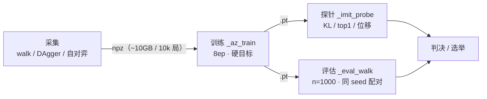
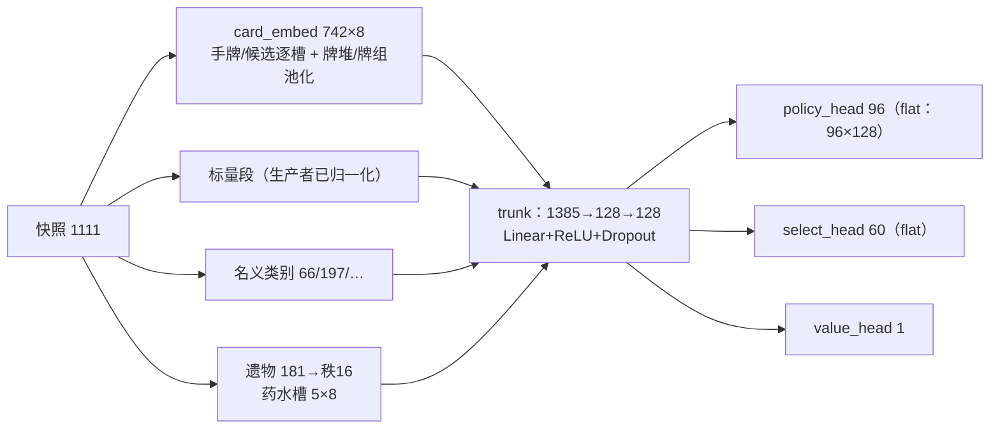

# 战斗网络 · 阶段性总结

> 更新：2026-09-24 晚（DAgger v2 已结案、容量轴在跑、自对弈 v1 待开）
> 范围：**战斗侧**（单场战斗策略）。整局（run）网络线不在本文。
> 约定：本文只写"**已固化**的事实与读数"；实验过程与逐次推导在 `.agent/notes.md`，
> 本文件随线滚动更新"当前读数"与"已结案"两节。

---

## 0. 一页速览

**任务**：单场战斗的策略网络（铁甲战士，Ascension 0，对齐真机测试环境）。
教师 = 引擎内 C++ UCT 搜索（「作弊」口径：搜索看得到本局真实未来抽牌顺序）；
学生 = AZNet，**裸网（无搜索）= 公平口径**。

**链条**（详见 §4）：



**当前读数**（n=1000，seed 20000..20999 同 seed 配对；e8 两臂跨轮**逐位一致** = 评估完全可复现）：

| 策略 | 场胜率 | 口径 | 备注 |
|---|---|---|---|
| 教师 4000 sims | **93.0% ±0.4** | 作弊 | 上界参照 |
| 教师 500 sims | 92.3% ±0.5 | 作弊 | |
| e8 裸网 | **89.8% ±0.6** | **公平** | 1 万局 walk 数据、8ep |
| e8·MCTS(100) | 92.4% ±0.5 | 作弊 | 搜索补偿 |
| dagger1 裸网 | **90.4% ±0.6** | **公平** | DAgger v1（+0.6pp） |
| dagger1·MCTS(100) | 92.4% ±0.5 | 作弊 | |
| dagger2 裸网 | **89.9% ±0.6** | **公平** | DAgger v2（对 e8 仅 +0.1pp） |
| dagger2·MCTS(100) | 92.3% ±0.5 | 作弊 | |

**搜索轴阶梯**（n=300，seeds 20000+，底网 = dagger2 同一权重）：
裸 **89.9% ±1.1** → M100 **92.2% ±0.8** → M200 **92.6% ±0.8** → **M500 93.1% ±0.7**
（场/局 9.9→14.6、终局层 16.8→25.6）⇒ **搜索仍在上行**，M500 已到教师 4000 级（93.0%）。

**四条已结案**：
1. **训练量轴关闭**：e2→e8→e32（4× 训练量）裸网胜率 Δ≤0.1pp（val 指标仍改善 ⇒ 只是更拟合教师）。
2. **软目标结案（复现 4 次）**：策略目标一律用教师访问分布的**硬 argmax one-hot**；
   软化在 4 个场景全部更差（见 §3.3）。
3. **搜索补偿有效、且仍未饱和**：M100 ≈ 92.4%（n=1000，对底网代际不敏感）；
   n=300 阶梯 M100/M200/M500 = 92.2 / 92.6 / 93.1 ⇒ 缺口在裸网的**价值/规划**，不在策略头。
4. **分布轴（DAgger）一阶效应结案**：v1 +0.6pp（边缘）、v2 **+0.1pp**（vs e8，CI ±0.6）
   且相对 v1 是 −0.5pp ⇒ 分布纠正**不可累积**；规划型仗（GREMLIN_LEADER 42%、
   COLLECTOR 4%、CHAMP 6%、AUTOMATON 3%）与 e8 同形。

**进行中**：容量轴（hidden 128/256/512 × 2 seeds，固定数据/配方；GPU 快车道在调）。
**规划中**：自对弈 v1（自身 PUCT 当标签、温度采样、迭代复利；靶预算改 **M200**——见 §6.3）。

---

## 1. 系统全貌

```
  ┌ 数据 ─────────────────────┐   ┌ 网络/搜索 ────────────────┐   ┌ 评估 ─────────────┐
  │ walk / DAgger / 自对弈     │   │ AZNet（§2.3）            │   │ _eval_walk（§3.4）│
  │ npz：obs+π+m+z+enc+fp…     │──▶│ PUCT 搜索（§2.4）        │──▶│ 探针 _imit_probe  │
  └────────────────────────────┘   └───────────────────────────┘   └───────────────────┘
```

数据、训练、评估三者**同源同口径**：同一套随机化（逐场资源重生成）、同一把
train/val 刀（`battle_split(group=seed)`）、同一套种子纪律（训练 0..999 / 评估 ≥ 20000）。

---

## 2. 网络结构

### 2.1 观测（`azlayout.py`，OBS_DIM = **1111**，网络输入 **1385**）

- 布局**唯一来源**是 C++ 的 `sts.snapshot_layout()`；Python 端全部推导 + 断言
  （防止「改了 C++ 忘了 Python」的静默漂移）。**改布局 ⇒ 观测宽度变 ⇒ 旧缓存/旧权重作废**
  （由 `obs_dim` 标记闸挡住）。
- 块构成（当前布局，共 **1111**；下表宽度 = **快照里的原始列数**，不是网络里的宽度）：

| 快照块 | 宽度 | 内容 / 消费方式 |
|---|---|---|
| player | 8 | curHp, maxHp, block, energy, turn, inputState, cardSelectTask, outcome |
| counts | 7 | monsterCount, **monstersAlive**, handSize, drawSize, discardSize, exhaustSize, **deckSize** |
| hand | 10×4 = 40 | [cardId, costForTurn, specialData, playable] —— 逐槽嵌入 + 逐槽数值 |
| draw/discard/exhaust | 3×60 = 180 | 只给 `cardId`，**集合池化** |
| master deck | 64 | 只给 `cardId`，集合池化（张数在 `counts.deckSize`） |
| monsters | 5×12 = 60 | [id, curHp, maxHp, block, intentMoveId, targetable, intentDamage, intentHits, **halfDead, escapeNext, isEscaping, miscInfo**] |
| player attr | 3 | stance, orbSlots, energyPerTurn |
| player counter | 13 | 本轮出牌/弃牌计数（6）+ 遗物 counter（penNib/happyFlower/incenseBurner/inkBottle/nunchaku/sundial/orangePellets） |
| player status | 87 | 下标 = `PlayerStatus` 枚举值 |
| monster status | 5×43 = 215 | [怪物][`MonsterStatus` 枚举值] 展平 |
| card select 候选 | 60×4 = 240 | [cardId, cost, costForTurn, specialData]，槽 k == `select_card(k)` |
| select meta | 4 | candidateCount, pickCount, canPickZero, canPickAnyNumber |
| run context | 2 | floor, gold |
| 资源 | 188 | 遗物 181（多热）+ [potionCount, potionCapacity] + 逐槽药水 id 5 |

- 网络输入 **1385** = 卡牌段 592（手牌 10×8 + 候选槽 60×8 + 4 个池化块 ×8）
  + 名义类别 140 + 标量段 597 + 资源 56（遗物池化后 16 + 药水槽 5×8）。
- ⚠️ **`runCtx` 只留 `[floor, gold]`**（2026-09-24 用户定调，从 10 → 5 → 3 → **2**）：
  砍掉的三样都**不是观测该有的东西** ——
  · **地图**（曾 22 维，与 `runlayout.map_features()` 同源）：处于哪个地图节点对“本场怎么打”
    没有实质影响，而**构造场景根本没有地图** ⇒ 只会让数据合成变难。
    （run 网那边的 `map_ahead` 不受影响 —— 它决定的是**走哪条路**，那是地图决策。）
  · **isElite / isBoss**：与 `monster_id` 的嵌入**完全等价**（知道怪是谁就知道它是不是
    Boss/精英）⇒ 纯冗余；而且拿 `encounter` 推它本身就是个坑（Act4 精英 `SHIELD_AND_SPEAR`
    不在 `elites[][]` 表里；`Event::DEAD_ADVENTURER` 又把表里的 `THREE_SENTRIES`/`GREMLIN_NOB`
    发到事件房）。引擎内部的 `ScumSearchAgent2` 仍按 `isBossEncounter` 给 3× **搜索预算**
    —— 那是预算，不是观测。
  · **act**：**完全由 floor 决定**（一层一节点、floor 单调递增；实测 act1 = floor 1..16）。
- **名义类别**（取值大小无意义，除数必须=1）：`monster_id`(66)、`intent_move_id`(197)、
  `input_state`、`card_select_task`、`outcome`、`stance`——由 `CAT_SPEC` 声明消费方式（共 14 位）。
- **卡牌 id** = `raw*2 + upgraded`，嵌入表 742 行（0 = INVALID/空槽）。
- **牌堆只给集合**：不给堆序（真实游戏里堆序不可见，给序=读预言机的
  隐藏信息）。空槽掩掉后 **mean 池化**（sum 会把"有几张"混进"是什么牌"，冗余且尺度漂）。
  明确代价：`Havoc / Mayhem / Warcry / Headbutt` 4 张"看堆顶"的牌失去该能力（已知小集合）。
- **遗物** = 多热实体 → `MultiHotEmbed`（显式声明秩 16；多热直进 Linear ≡ 嵌入之和）；
  **药水** = **逐槽 id 查表**（不做袋子多热：动作是槽位寻址的，两瓶不同种时同一观测
  对应后果不同的动作）。药水袋子多热块已于 2026-09-24 **从快照里删除**（它是槽列表的
  置换不变投影，而且`SKIP_IDX` 本就没把它喂进网络）。
- **怪物槽从不压缩** —— `monsterCount` **含尸体**（`die()` 只 `--monstersAlive`），
  因为槽位 = 怪物身份，一压缩后面所有 `curHp` 就错位。`halfDead` 等 4 列是为此补的：
  旧口径下 `targetable = !isDeadOrEscaped()` 是一个**析取**，
  「永久尸体 / 待复活（觉醒者一阶段、暗灵 REGROW）/ 逃跑中 / 已逃」
  **四种状态逐位相同**（实测证据见 `_chk_revive.py`，27 条断言）。
- **`isElite` / `isBoss` 取自房间类型**（`bc.roomKind` = `gc.curRoom`，从地图节点抄的），
  **不拿 encounter 猜**：Act4 精英 `SHIELD_AND_SPEAR` 不在 `elites[][]` 表里（会漏报）；
  `Event::DEAD_ADVENTURER` 会把精英表里的 `THREE_SENTRIES`/`GREMLIN_NOB` 发到**事件房**
  （会假阳性）；而「大怪带小怪」的阵容长相根本不是判据。只有合成场景才退回 encounter 表。
- **选牌区门控（无条件）**：非 `CARD_SELECT` 帧把选牌区 **245** 列置 0 —— 引擎
  `cardSelectInfo` 从不清零，残留值会变成"本局发生过哪种选牌"的历史指纹（过拟合面）。
- **资源恒可见**：置 0 会救 val R² 但遗物确实决定胜负（+42.5pp）⇒ “不该丢输入”。

### 2.2 动作空间（`azaction.py`，POLICY_DIM = **96** / SELECT_DIM = **60**）

统一动作索引（权威在 C++ `bindings/bindings-util.cpp` 的 `actionToIdx`）：

```
 0..59   打牌：hand*6 + t      t=0 无目标 / 1..5 → 怪物 0..4
60..94   药水：slot*7 + pt     pt=0 无目标 / 1..5 怪 / 6 丢弃
95       END_TURN
CARD_SELECT 帧改用 select_head：60 维 = 候选块槽号（位置有意义）
```

- **编码守卫：响亮失败**（`ActionEncodingError`）。查的是**单射性**，不只是范围——
  历史上「药水打第 5 怪」会撞成「丢弃」（下标合法、静默污染标签，范围检查抓不到）。
  新场景先跑 `_chk_actions.py`。
- **掩码 = 游戏的真实合法集**（`enumerate_actions`），**不是**"搜索树访问过的边"
  （后者曾错 4 天：策略头永远学不到没被探过的动作，含 END_TURN）。对拍：`_chk_mask.py`。
- 药水动作网格 5 槽 × 7 目标；手牌上限 10 槽；怪物槽 5。

### 2.3 网络主体（`aznet.py`，唯一入口 + 全量重导出）



- **当前生产配置**（v4 系权重实载）：`hidden=128, depth=2, dropout=0.2, arch=flat, sel_arch=flat,
  pair=none`；嵌入宽度**每类各自一个**：`card_rank=8, monster_rank=8, intent_move_rank=8,
  relic_rank=16, potion_rank=8`；**总参数量 225,461**（0.22M，小模型；默认 flat 实测）。
  LR=1e-3 / WD=1e-4 / batch=256。trunk 输入 **1385** 维（随布局/开关变；改 in_dim = 作废旧权重）。
- 输出三元组：`(p_act[96], p_sel[60], value[1])`。**调用方负责 `net.eval()`**（dropout）。
- 手牌进 trunk 只有**一种**方式：逐槽拼（`slot`）。旧开关 `hand_pos`（`pool` = 手牌按集合池化
  ——**改 in_dim ⇒ 作废旧权重**）已于 2026-09-25 随它的 A/B 臂一起删除。
- **factor 家族**（研究项，已实现、做过 A/B）：策略头把 `(手牌槽 × 目标)` 网格化后**共享
  打分函数**（logit = q(s) + k(牌) + k(怪/目标)，可加满秩双线性配对项）；目标 key 带怪本回合
  数值（"该打谁"≈"谁快死了"）；手牌 key **必带**费用/可打（不给=信息丢失）；药水走同一机制
  的 5×7 网格；select 头同理（扁平头在 CARD_SELECT 行上一致率 39.2%，因子化的增益全部来自
  "跨槽位共享打分"）。A/B 结论与保留状态见 notes；**线上权重仍是 flat**。
- ⚠️ 速查禁区：别给 `card_embed`/`potion_embed` 加 `padding_idx=0`（实测 train_ce 0.685→0.022
  / val_ce 0.96→1.89 = 从学策略变成背训练集）；两套行 0 约定别混（多热行 0 = padding）。

### 2.4 搜索（`azsearch.py`）

- **PUCT（AlphaZero 式）**：网络给先验 + 叶值，**不做随机 roll-out**；树模拟全走
  C++ `BattleContext.clone() + execute()`（确定性）。
- `mcts_search(net, b, sims)` → `(idx→N, idx→Action)`；`mcts_action` = argmax 访问数。
- batch 纪律：`batch=1` 与旧实现**逐位等价**；`batch=4` 加速 ~2.5×；**`batch=32` 胜率崩 −19pp**
  （换 batch 必须先重测下游胜率）。`STS_MCTS_BATCH` 控制，`c_puct=1.5`。
- 口径：搜索用本局真实未来抽牌（**作弊**）——搜索强度 ≠ 公平代理强度；引用数字必须带口径。
- 实测梯度：MCTS 增益随预算上升不衰减（boss 场景、8000 标签、3 seeds × 200 局）：
  裸 28.2% → M20 34.5% → M100 36.8% → **M500 42.7%**。- **walk 线复现（2026-09-24，n=300，底网 dagger2）**：裸 89.9% → M100 92.2% →
  M200 92.6% → **M500 93.1%**（教师 4000 = 93.0%）⇒ 部署口径下搜索**仍未饱和**。
---

## 3. 训练组件

### 3.1 数据（npz）

- 格式（`_az_train._assemble` 组装，`train()` 直接消费）：
  `obs / pi_act / pi_sel / m_act / m_sel / z / bid / seed / enc / fp / src / space`
  （另有终局列供换 z 口径；`enc` = 遭遇名，`src` = 数据源标记）。
- **三条采集线**：
  | 线 | 场景 | 特点 |
  |---|---|---|
  | `collect`（boss） | 单 Boss（`_boss.make_boss_battle`） | 历史线；96.7% 样本单怪，已被 walk 取代 |
  | `collect_walk.py` | 整局漫游当**真实触发器** | 真实多怪组合；逐场资源重生成（v4：加量+随机升级）；10k 局 / 138,419 场 / **2,073,291 样本** / 10.9GB |
  | `collect_dagger.py` | 学生跑、教师标 | 同 walk 环境同 seed ⇒ 同遭遇序列；β=0.5 混合执行；10k 局 / 118,434 场 / 1.76M 样本 |
- **规模事实**：walk v4 教师场胜率 92.8%、13.8 场/局、多怪样本级覆盖 51.6%；
  act3 仍靠万局涓流（n800 时代 act3 覆盖 ≈ 0）。
- **fp 纪律**（防"旧缓存训新场景"的静默错配）：`scenario_fp()`（卡组/遗物/升华/前 8 场景
  内容 SHA1）⊕ 各采集器语义版本 ⇒ `walk_fp()` / `dagger_fp()`；`train()` 逐份比对，
  不一致 → 响亮拒绝。采集语义一变必须升版本（旧缓存作废）。

### 3.2 教师

- 引擎内 **C++ UCT**（`b.search_stats(sims)`）：返回访问分布 π（软标签记录）、
  真实合法掩码、root 胜率。预算参照：boss 8000 / walk、DAgger 4000。
- **训练目标是硬 argmax one-hot**（`hard_target(π)`）——实测结论，见 §3.3。
- `eps>0` 均匀探索：制造失败轨迹给 value 学（`_walk.py ... eps`）。
- 种子纪律：教师的"种子"= 战斗起始状态；训练用 `TRAIN_SEED0..`（0..999），
  **绝不碰** `EVAL_SEED0`（held-out）。`_assert_train_seeds()` 强制。

### 3.3 训练器（`_az_train.py train()`）

- 超参：Adam（LR 1e-3, WD 1e-4），batch 256，epochs 默认 40（**大数据线一律 8ep**——
  1k/5k/20k 规模曲线同用 8；8ep ≈ 20–22 min / ~2M 样本）。
- 设备：`STS_DEVICE`（默认 cpu）+ `STS_BATCH`/`STS_LR`（默认 256 / 1e-3 = 历史配方）。
  cuda 路径把数据集整批上卡；**大 batch 路线仍在校准**（batch 4096/8ep 欠训、lr 1.6e-2 崩）
  ⇒ 生产仍走 CPU 配方。⚠️ 跨设备/跨 batch 是**独立配方队列**，不与历史逐位可比。
- **损失 = 策略交叉熵（act + select 双头，掩码）+ value MSE**；指标：
  `train/val ce`（策略）、`R² = 1 − MSE/var`（值）。分块 eval 计算（先 `net.eval()` 再算）。
- **目标形式（已结案 4 次）**：硬 argmax one-hot ≫ 软化访问分布。
  证据（boss 场景 200 局）：硬 vs 软 = 裸网 **31.0% vs 18.5%**、M500 59.0% vs 53.5%，
  且 val_R2 不动 ⇒ 损伤全在策略目标本身。walk v3 复现：n=1000 硬 87.6% vs 软 86.2%
  （软目标分布更"忠实"却更不会赢——KL/NLL软 与胜率反相关）。`STS_SOFT_TARGET` 仅为溯源保留。
- **值目标 z（默认口径 `enginenorm`）**：`sts.evaluate_end_state(b) / (100 * max_hp)`
  —— **引擎自己的终局分**（`BattleScumSearcher2::evaluateEndState`，赢败两支都取自它：
  赢 = `100*(35 + curHp + 4*药水 − 0.01*回合)`，败 = 敌方剩血比 / 活怪数 / 能量浪费 / 抽牌 / 药水 / 回合 的组合）。
  实测（40 场 @500 sims）：赢 ≈0.48~1.24、败 ≈0.0006~0.0015 ⇒ 序成立，落差 **0.477**
  （`old` 是 1.0+）。⚠️ `q = W/N` 未归一化 ⇒ 尺度变化就等于改探索强度：换口径先扫 `c_puct`。
  换口径 = 换任务（`Z_SPEC` 家族：enginenorm/old/hp_turn，需终局列 + 双自检）；
  **2026-09-28 之前的历史数字只与 `--z-spec old` 同口径**。
- **切分**：`battle_split(group=seed)` 按**局**切 train/val（val 20%）——同局战斗共享
  卡组/血量上下文，必须同侧；混源数据必须传 `group=seed` 防泄漏（旧缓存回退按 bid，会泄）。
- **三道数据闸**（每次 train 前跑）：`check_scenario_fp`（fp）、`check_action_space`
  （space=POLICY_DIM 标记）、`check_cache_obs`（obs_dim 标记）；外加确定性自检
  （两次前向逐位一致——模块曾因忘记 `eval()` 被 dropout 坑过）。
- **可复现性**：**线程数是配方的一部分** —— 换线程数就换轨迹（1 vs 8 实测 `max|Δw|` 0.65~0.89）；
  定住线程数之后，跨进程与跨 torch 版本（2.8/2.12）都逐位相同。旋钮 = `--train-threads`
  （2026-09-28 起默认 **1**），守卫 `_chk_threads.py`。（旧说法「8 线程下跨进程不可复现」
  见 `.agent/memory/sts-lightspeed-rl.md` 续十三的勘误。）
- 运维向：进度条恒开（`script` pty）；看门狗 `JOB_TIMEOUT` 按 **累计静默** 判死（曾误杀
  10.9GB npz 加载静默期——教训：判据要累计时间差、日志打实测量）。

### 3.4 评估与探针

- **`_eval_walk.py`（主评）**：把策略放进与训练**逐位同分布**的漫游里打 n 局（默认 n=1000，
  seed0 ≥ 20000）；同 seed 多策略**逐位配对**；输出：场胜率 ±CI、按幕/房间/怪群拆表、
  JSON（`per_act/per_room/per_encounter`）。"大 n 抹噪声，别改随机化"。
  ⚠️ 传参用逗号（分号会被三层 shell 吃）；裸网 200 局 ≈ 3 s，M100 1000 局 ≈ 28 min。
- **`_imit_probe.py`（探针，不重训）**：KL(π师‖π网)、top1、NLL 硬/软、**温度校准 KL***、
  置信分层、**跨权重位移**（TV / argmax 一致率）。**指标纪律：读 NLL硬/top1/KL\*——
  原始 KL 会因"硬目标锐化"误导**（见 §5）。
- **`_eval_walk.py`（主评，同分布漫游）与 `_imit_probe.py`（离线探针）**：胜率必须带教师参照、
  看 N0→N1 差值、多怪是“表示装不下”与“策略不泛化”两回事。（原「换场景泛化评估」
  `_gen_eval.py` / `_eval_encs.py` **已于 2026-09-30 退役**。）
- **同 seed 配对的噪声带**：n=1000 时各臂 ±0.5~0.6pp；e8 臂多轮重跑**逐位一致**
  ⇒ 评估本身零漂移，"涨/平/跌"只归因于策略。

---

## 4. 训练过程链条（运维与流程）

### 4.1 基建（本仓库纪律）

- 单向同步：**本地 = 唯一真相**（`./_sync.sh push`）；远端跑在 tmux + `script` pty 里，
  日志 `job-*.log`；完成判据 = 日志尾部 `COMMAND_EXIT_CODE` 的**数值**（137=SIGKILL≠完成）。
- 多棒流水线用 `./_chain.sh <等谁完成> <下一棒>` 接力（防串位：只认守望开始**之后**
  被重写的日志）；本地 `./_sync.sh wait <日志>` 是**静默完成触发器**（人要看直播用 attach）。
- 目标必须显式：`STS_SESSION` 与会话名/脚本名一律**无默认值**（防"没写目标就起跑"）。

### 4.2 一次标准四棒（实测耗时）

```
 采集（10k 局）       ~77 min
 → 训练（8ep）         ~22 min
 → 探针（两 ckpt）     ~25 min
 → 评估（n=1000 六臂） ~68 min
   ────────────────────────────
   合计 ≈ 3.2 h / 轮
```

### 4.3 实验史时间线（浓缩）

1. **boss 线**（历史）：单 Boss 采集/训练/评估闭环；发现 96.7% 单怪 ⇒ 真机首战外推崩。
2. **walk v3/v4**（09-23）：整局漫游当触发器，真实多怪；资源逐场重生成（v4 加量 + 随机升级）。
   万局采集完成 → e8 基线 89.8%（裸）/ 92.4%（M100）。
3. **e32 收轴**（09-24）：4× 训练量 Δ≤0.1pp ⇒ 优化预算轴关闭（val 改善 ≠ 会赢）。
4. **DAgger v1/v2**（09-24）：v1 裸网 +0.6pp（边缘）、规划仗成片上移；v2 对 e8 **+0.1pp**、
   对 v1 −0.5pp ⇒ **分布轴一阶结案**（不可累积）。
5. **搜索轴**（09-24 晚，n=300）：裸/M100/M200/M500 = 89.9/92.2/92.6/**93.1** ⇒ 未饱和。
6. **下一步**：容量轴（在跑）→ 自对弈 v1（靶 M200）→ 构造采集（未写）。

---

## 5. 纪律与坑（速查）

- **口径必须带**：裸网 = 公平；`teacher:` / `net:…:sims` = 作弊。混引=错结论。
- **静默错配五家族**（全有闸）：fp（场景）、space（81→96 语义）、obs_dim（布局）、
  掩码语义（合法集 vs 访问边）、选牌区残留（历史指纹）。新场景先跑 `_chk_actions.py`。
- **指标**：NLL硬 / top1 / 校准 KL\*；原始 KL 会被锐化伪影带偏；软指标与胜率反相关。
- **评估**：n=1000 配对的 CI ≈ ±0.6pp；跨轮比较靠"同 seed 配对 + 逐位复现"。
- **训练**：硬目标、8ep、threads 纪律、`group=seed` 切分。
- **工程坑**：中文 Windows GBK 输出（`PYTHONUTF8=1`）；npz 加载静默期（看门狗已修）；
  参数含 `;` 穿三层 shell 会被吃（用逗号）；日志先落盘再 grep。

---

## 6. 当前状态与下一步

### 6.1 已固化产物（远端 data/）

`walkdata_v4_n10000_s4000.npz`（10.9GB）· `walk_v4_n10000.pt`（e8）· `walk_v4_e32.pt` ·
`walk_v4_dagger1.pt` · `dagger_v1.npz` · `imit_probe_v4_e32.json` ·
`evalwalk_v4_e32_n1000.json` · `evalwalk_v4_dagger1_n1000.json` · `dagger_v2.npz` ·
`walk_v4_dagger2.pt` · `imit_probe_dagger2.json` · `evalwalk_v4_dagger2_n1000.json` ·
`evalwalk_search_n300.json`；
在跑：容量轴 `cap_h{128,256,512}_s{0,1}.pt`（GPU 快车道）→ 离线探针 → n=1000 配对评估。

### 6.2 开放轴（未探）

- **容量（进行中）**：hidden 128/256/512 × 2 seeds、固定数据与配方；GPU 快车道已装
  （`STS_DEVICE`/`STS_BATCH`/`STS_LR`），**配方校准中**（batch 4096 欠训、lr 1.6e-2 崩 ⇒ 回落
  历史配方 + 6 路并发）；
- **目标结构**（value 侧：n-step / 分层 z；策略侧已结案为硬目标）；
- **自对弈复利**（§6.3）；
- 三兄弟 `COLLECTOR / CHAMP / AUTOMATON` 裸网 ≈ 0%（教师也只有 6–20%）——"数据里没有解"待归因。

### 6.3 自对弈 v1（设计 v0.1，待定调）

自我对局 + 自身 PUCT 当标签（信息结构与学生同源，不依赖固定教师）：
执行 = 访问分布 **T=1 温度采样**（防同轨迹复读）；π 标签 = 自身访问分布；
z = 真结局口径不变；**采集预算改 M=200**（依据 §0 搜索阶梯：GREMLIN_LEADER 裸 14% →
M100 25% → **M200 46%** → M500 50%，M100 的靶太弱）⇒ 10k 局 ≈ 8–10h；每轮 n=1000 选举，
上限 3 轮；采集与 walk 同 `walk_fp` ⇒ 可合法混训防遗忘。
关键待答问题：**M100 对底网代际不敏感（两代都 92.4）⇒ 自复利是否真实存在**（靶改 M200 就是冲着这个问题去的）。

---

## 附录 A · 文件索引（战斗线）

| 文件 | 一句话 |
|---|---|
| `azlayout.py` | 观测布局 → 下标/归一化/名义类别（纯数据层） |
| `azaction.py` | 动作空间 + 编码守卫 + `teacher_action`/`net_action`/`random_action` |
| `azsearch.py` | PUCT 搜索（`MCTSNode/mcts_search/mcts_action`） |
| `aznet.py` | AZNet（trunk + 三头）+ 对以上三者的**全量重导出**（唯一入口） |
| `multi_hot.py` | 遗物多热池化（显式秩）/ 药水槽列表池化 |
| `_az_train.py` | **唯一训练脚本**：collect / selfplay / train / eval / seeds |
| `collect_walk.py` | 漫游采集（真实多怪；v4 资源口径） |
| `collect_dagger.py` | DAgger 采集（学生跑、教师标、β 混合） |
| `_boss.py` | Boss 场景与卡组/遗物生成（`scenario_fp` 的锚） |
| `_walk.py` | 整局漫游 harness（库，无 CLI）+ 策略 spec（`random/teacher/net`）装配 |
| `_eval_walk.py` | 同分布 n=1000 胜率评测（主评） |
| `_imit_probe.py` | 模仿探针（KL/top1/NLL/校准 KL*/位移） |
| `_gen_eval.py` | 泛化评估（换场景，四条阅读纪律） |
| `_diag_head.py` | 头级诊断（39.2% 一致率的来源） |
| `_chk_all.py` | 守卫总检（engine/data 两档）；重点：`_chk_pool/_chk_mask/_chk_actions/_chk_bossrelic` |
| `_sync.sh` / `_chain.sh` / `_wait_logs.sh` | 远端同步 / 接力链 / 静默守望 |

## 附录 B · 术语表

- **裸网**：无搜索、单次前向 argmax —— 唯一公平口径 / 真机部署口径。
- **M100 / M500**：net-PUCT 100/500 sims（作弊口径）。
- **教师**：C++ UCT 搜索（sims 预算可调）。
- **fp**：场景指纹（卡组/遗物/升华/语义版本），采集器一改必须升版本。
- **held-out**：`EVAL_SEED0` 起的种子段，训练数据绝不用；万局采集显式 `STS_EVAL_SEED0=20000`。
- **逐位一致**：同一输入两次运行输出完全相同（本项目对确定性/可复现的最高要求）。
